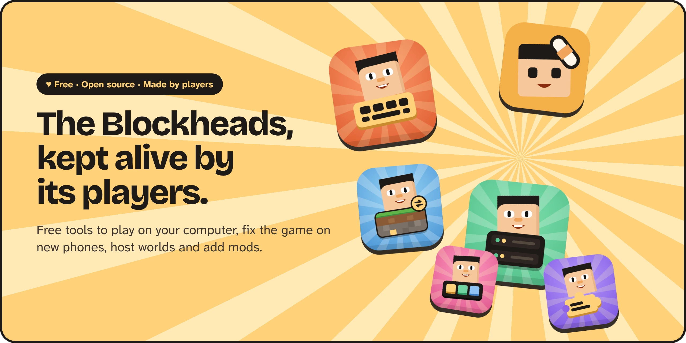

  

  
  
  
  

  Free, open-source, community-made tools for <b>The Blockheads</b>. 
  <b>Bring your own copy of the game:</b> our projects contain no game files and download none.

## 🎮 Pick what you want to do

<table>
  <tr>
    <td align="center" width="33%" valign="top">
      
      <h3><a href="https://github.com/Blockheads-Club/blockheads-pc">Blockheads PC</a></h3>
      Play on your computer: Windows, macOS and Linux, with mouse, keyboard or a controller.
    </td>
    <td align="center" width="33%" valign="top">
      
      <h3><a href="https://github.com/Blockheads-Club/blockheads-patcher">Patcher</a></h3>
      Fix the frozen popup and crashes on new phones. Right in your <a href="https://blockheads.club/patcher/">browser</a>.
    </td>
    <td align="center" width="33%" valign="top">
      
      <h3><a href="https://github.com/Blockheads-Club/blockheads-server">Server</a></h3>
      Host worlds for friends on your PC, a Raspberry Pi, Docker or your phone.
    </td>
  </tr>
  <tr>
    <td align="center" valign="top">
      
      <h3><a href="https://github.com/Blockheads-Club/world-tool">World Tool</a></h3>
      Move, back up and edit your worlds between phones, PC, iPhone backups and servers.
    </td>
    <td align="center" valign="top">
      
      <h3><a href="https://github.com/Blockheads-Club/mod-sdk">Mod SDK</a></h3>
      Make mods in Lua, Rust, C, Go, Zig or Java: commands, minigames, hats, items.
    </td>
    <td align="center" valign="top">
      
      <h3><a href="https://github.com/Blockheads-Club/mods">Mods</a></h3>
      The public, reviewed mod list. Browse it at <a href="https://blockheads.club/mods">blockheads.club/mods</a>.
    </td>
  </tr>
</table>

  🌐 <a href="https://blockheads.club/"><b>blockheads.club</b></a> — downloads, guides and docs
  (<a href="https://github.com/Blockheads-Club/website">source</a>)

## 🧭 Popular guides

- 🩹 [Fix the game on your phone](https://blockheads.club/docs/guides/fix-game-on-phone)
- 📦 [Get your game APK](https://blockheads.club/docs/guides/get-apk)
- 🛟 [Back up your worlds](https://blockheads.club/docs/guides/backup-worlds)
- 🌐 [Open your server to the internet](https://blockheads.club/docs/guides/open-internet)
- 🧩 [Make your first mod](https://blockheads.club/docs/mods/first-lua-mod)

## 🤝 Join in

Everyone can open issues and pull requests in the project repositories. Bug reports from real devices help the most,
and so do translations and fixes to the guides. All projects are in early (alpha) pre-release.

## 📄 License

The apps and the website are **GNU GPLv3 or later** (GPL-3.0-or-later). The mod SDK is MIT OR Apache-2.0, the mod
index CC0; each mod chooses its own licence.

Unofficial fan project. Not affiliated with, endorsed by or connected to Majic Jungle or Noodlecake Studios.
"The Blockheads" belongs to its respective owners.
